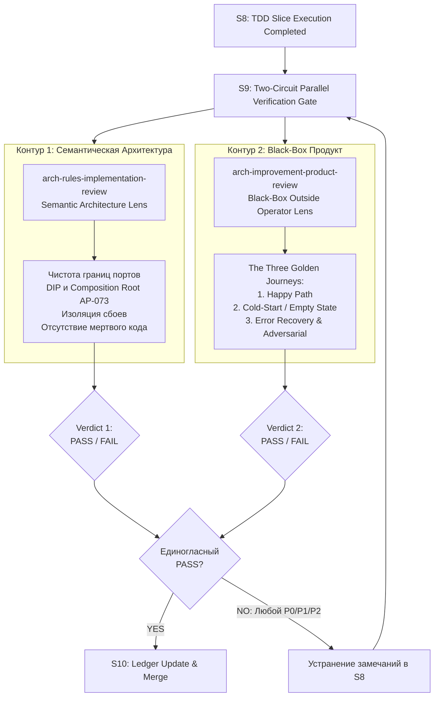

# Архитектурный План Трансформации Durable-Zero: Суверенное Ядро, Стратегии и Отпиливание Велосипедов

> **Статус:** План утверждён к последовательной реализации через Arch Improvement Loop  
> **Дата:** 2026-11-03  
> **Проект:** `durable-zero` (`/Users/vanya/Projects/durable-zero`)  
> **Стандарты:** Ports & Adapters (Hexagonal), Strategy Pattern (AP-072), Composition Root (AP-073), Dual-Circuit Semantic Review (S9), Zero Backwards-Compatibility Shims.

---

## 1. Концепция и Архитектурное Видение

`durable-zero` трансформируется в **автономный, суверенный headless-рантайм агентов**:
1. **Никаких завязок на конкретные IDE:** в ядре отсутствуют понятия «BB Provider» или «Zed Adapter». Внешние клиенты (BB IDE, Zed, VSCode, CLI, TUI, Telegram-боты) общаются с движком исключительно через стандартизированный Inbound Transport (JSON-RPC 2.0).
2. **Разделение Inbound (Driving) и Outbound (Driven) адаптеров:**
   - *Inbound Adapters (Снаружи ядра):* JSON-RPC 2.0 over stdio / WebSocket слушают входящие команды и вызывают методы движка (`engine.submit()`, `engine.abort()`). Движок НЕ знает про сокеты и стримы.
   - *Outbound Ports (Исходящие порты ядра):* среда исполнения, хранилище секретов, скиллы, песочница скриптов, долговечное хранилище задач.
3. **Инверсия зависимостей (DIP, AP-072, AP-073):** декларации портов строго отделены от их использования; инстанцирование и выбор стратегий происходят исключительно в **Composition Root** на основе конфигурации (`zero.config.ts`).
4. **Bold Refactoring (Без шимов и легаси-костылей):** проект находится в активной разработке. Устаревший самодельный код вырезается сразу, без временных адаптеров обратной совместимости.
5. **Опираемся на стабильные низкоуровневые слои upstream Pi 1.5.0:**
   - Слой 0 (Модели): `@earendil-works/pi-ai` (`createModels()`).
   - Слой 1 (Транспорт и дельты): `@earendil-works/chord` (`ipcLink`, `forkDriver`, `createHostManager`, `telemetry-sqlite`).
   - Слой 2 (ACID задачи, транскрипт и граф): `@earendil-works/pi-durable` (`ownership: { kind: "task" }`, `ConversationTranscript`, `watchTaskGraph`).
   - Слой 3 (Агентский цикл): `@earendil-works/pi-agent-core` (`Agent`, `agentLoop`, хуки `beforeToolCall`/`afterToolCall`).
   - **Что отпиливаем:** интерактивный CLI-пакет `@earendil-works/pi-coding-agent` (темы терминала, TUI, глобальный `~/.pi/agent`).

---

## 2. Спецификация Портов и Стратегий

```
 contracts/src/ports/
 ├── execution-env.port.ts   <- IExecutionEnvPort (LocalNodeEnv vs RemoteSshEnv vs DockerEnv)
 ├── config-store.port.ts    <- IConfigStorePort (PiSettingsAdapter vs EnvConfigAdapter)
 ├── skill-provider.port.ts  <- ISkillProviderPort (LocalDirSkillLoader vs DatabaseSkillLoader)
 ├── agent-engine.port.ts    <- IAgentEnginePort (PiAgentCoreEngine)
 ├── sandbox.port.ts         <- ICodemodeSandboxPort (QuickJsWasmSandbox vs Cloudflare)
 └── storage.port.ts         <- ISessionStoragePort (SqliteWalStorage vs MemoryStorage)
```

Каждый порт объявляется как строгий TypeScript-интерфейс без зависимостей от реализации. Сборка объекта `DurableZeroEngine` выполняется в Composition Root:

```typescript
const engine = new DurableHostBuilder()
  .setExecutionEnv(config.envStrategy)       // default: LocalNodeEnv
  .setConfigStore(config.configStrategy)     // default: PiSettingsAdapter (~/.pi/agent)
  .setSkillProvider(config.skillStrategy)   // default: LocalDirSkillLoader
  .setStorage(config.storageStrategy)       // default: SqliteWalStorage
  .setSandbox(config.sandboxStrategy)       // default: QuickJsWasmSandbox
  .build();

// Inbound Transport находится СНАРУЖИ ядра:
const server = new StdioJsonRpcServer(engine);
server.listen();
```

---

## 3. Последовательные Циклы Арх-Лупа (5 Cycles)

Каждый цикл выполняется строго по конечной машине состояний:
`S1 Load Memory` → `S2 Context/DIP Map` → `S3 Design` → `S4 Review` → `S6 Plan Write` → `S7 Plan Review` → `S8 TDD Slice Execution` → `S9 Dual-Circuit Verification Gate` → `S10 Ledger Update` → `S11 Learn Gate`.

---

### Цикл 1: DIP, Стратегии и Composition Root (AP-072, AP-073)

- [ ] **Task 1.1: Контракты портов в `packages/contracts/src/ports/`**
  - Объявить `IExecutionEnvPort`: `readFile`, `writeFile`, `exec(argv)`, `listFiles?`, `openTerminal?`, `cleanup`.
  - Объявить `IConfigStorePort`: `getSecret(key)`, `getSetting(key)`.
  - Объявить `ISkillProviderPort`: `loadSkills()`.
  - Объявить `ICodemodeSandboxPort`: `execute(code)`, `start(code, options)`, `close()`.
  - Объявить `ISessionStoragePort`: открытие SQLite/JSONL и управление транзакциями.
  - *Правило AP-073:* в файлах портов категорически запрещены дефолтные фабрики `createDefault()` или словари `FACTORIES = { ... }`.

- [ ] **Task 1.2: Реализация дефолтных стратегий**
  - Обернуть вызовы локальной файловой системы и процессов в `LocalNodeEnv` (`packages/core/src/adapters/env/local-node-env.ts`), имплементирующий `IExecutionEnvPort`.
  - Реализовать дефолтный `PiSettingsAdapter` (`packages/core/src/adapters/config/pi-settings-adapter.ts`), читающий `~/.pi/agent/settings.json` для локальной разработки, готовый к замене на `EnvConfigAdapter` для Docker.
  - Реализовать `LocalDirSkillLoader` для загрузки markdown-скиллов (`SKILL.md`).

- [ ] **Task 1.3: Создание `DurableHostBuilder` и Composition Root**
  - Реализовать `DurableHostBuilder` (`packages/core/src/bootstrap/host-builder.ts`).
  - Устранить прямое создание `new NodeExecutionEnv()` из `harness-setup.ts`. Зависимость передается через фабрику `ExecutionEnvFactory`.
  - Подключить вендор-нейтральную телеметрию `@earendil-works/chord/telemetry-sqlite` для записи спанов в SQLite.

- [ ] **Task 1.4: TDD верификация изоляции портов**
  - Написать юнит-тест с `MockExecutionEnv` (`packages/core/test/ports/mock-env.test.ts`), подтверждающий, что все операции тулов (`read`, `write`, `exec`) перехватываются мок-портом без обращения к диску Mac.

- [ ] **Task 1.5: S9 Dual-Circuit Review для Цикла 1**
  - Контур 1 (Семантическая Архитектура): проверка отсутствия утечек инфраструктуры в домен, соблюдение AP-010, AP-012, AP-072, AP-073.
  - Контур 2 (Black-Box Продукт): проверка стабильности старта движка с дефолтной стратегией.

---

### Цикл 2: Отпиливание Велосипедов Pi Durable (Zero Shims & Bind-before-Resume)

- [ ] **Task 2.1: Реализация инварианта Bind-before-Resume**
  - Гарантировать в `DurableZeroEngine`, что все сервисы памяти, телеметрии, наблюдатели и авторизаторы привязываются (`lifecycle.bind(harness, storage)`) **СТРОГО ДО** вызова `harness.resume()`. Восстановленные задачи не должны стартовать вслепую.

- [ ] **Task 2.2: Полная ликвидация самодельного subagent watcher/courier**
  - Удалить файлы: `subagent-courier.ts`, `subagent-delivery.ts`, `subagent-watcher.ts`, `subagent-delivery-types.ts`.
  - Перевести создание сабагентов на нативный `ownership: { kind: "task", taskId: api.taskId }` внутри коммита Durable (паттерн из `21-subagent-foreground.ts` / `22-subagent-background.ts`).
  - Доставку ответов сабагента в родительский контекст выполнять через встроенную фоновую задачу-репортер и метод `handle.submit()`.

- [ ] **Task 2.3: Полная ликвидация самодельного маппера графа задач**
  - Удалить 5 файлов: `runtime-graph-mapper.ts`, `runtime-graph-receipts.ts`, `runtime-graph-scope.ts`, `runtime-graph-source.ts`, `runtime-graph-state.ts`.
  - Подключить нативный вызов `harness.watchTaskGraph(context)`, транслирующий изменения статусов (`pending`, `running`, `waiting` с `on` и `policy`) напрямую клиенту.

- [ ] **Task 2.4: Переход на нативный `ConversationTranscript`**
  - Подключить `ConversationTranscript` из `@earendil-works/pi-durable`.
  - Реализовать метод `transcript.merge(watch.value)` для автоматического удержания скользящего окна сообщений, пагинации `loadEarlier()` и авто-заполнения пропусков `fillGap()`.

- [ ] **Task 2.5: Транзакционный `submit`**
  - Перевести отправку сообщений с внешнего `controller.submit` на атомарный `root.submit(tx, draft)` внутри `harness.commit()`.

- [ ] **Task 2.6: TDD верификация и S9 Review для Цикла 2**
  - Прогнать тесты на сабагентов, граф задач и историю транскрипта.
  - Контур 1: проверка чистоты кодовой базы от мертвого кода (минус ~900 строк велосипедов).
  - Контур 2: Happy Path прогона диалога с подагентом без зависаний.

---

### Цикл 3: Отвязка от `pi-coding-agent` → переход на `pi-agent-core` (+ LimitGate & CacheKeeper)

- [ ] **Task 3.1: Удаление зависимостей от `pi-coding-agent`**
  - Удалить импорты `@earendil-works/pi-coding-agent` из 18 файлов проекта.
  - Удалить вызовы `initTheme()`, `DefaultResourceLoader`, `SettingsManager`, `ExtensionRunner`, `resolveModelScopeWithDiagnostics`.

- [ ] **Task 3.2: Каталог моделей на базе `@earendil-works/pi-ai`**
  - Заменить `ModelRuntime` на легковесный вызов `createModels()` из `@earendil-works/pi-ai`.
  - Провайдеры и модели инициализируются строго в рамках сессии через `IConfigStorePort`.

- [ ] **Task 3.3: Интеграция стейт-машины `@earendil-works/pi-agent-core`**
  - Построить цикл генерации на базе `Agent` / `agentLoop` из `@earendil-works/pi-agent-core`.
  - Подключить хуки `beforeToolCall` (авторизация тулов, блокировка запрещенных операций) и `afterToolCall` (маскирование секретов, аудит).
  - Настроить параллельное исполнение тулов (`toolExecution: "parallel"`).

- [ ] **Task 3.4: Внедрение `LimitGate` и `CacheKeeper` (паттерны pi-pocket)**
  - Реализовать обертку `LimitGate` над стримингом моделей: засыпание при 429 rate-limits, canary-запросы при восстановлении квот, сохранение таймингов в `provider-limits.json`.
  - Реализовать `CacheKeeper`: автоматический фоновый пинг (maxTokens: 1) за 10 секунд до истечения 5-минутного TTL промпт-кэшей Anthropic/OpenAI.

- [ ] **Task 3.5: TDD верификация и S9 Review для Цикла 3**
  - Запуск тестов в изолированном окружении с пустой переменной `HOME` (без папки `~/.pi`).
  - Контур 1: проверка отсутствия скрытых глобальных синглтонов.
  - Контур 2: Cold-Start сценарий в пустой директории.

---

### Цикл 4: Чистый JSON-RPC 2.0 over stdio + chord IPC

- [ ] **Task 4.1: Реализация `StdioJsonRpcServer` (Inbound Adapter для внешних клиентов)**
  - Удалить `RunnerRpcChannel` (StringDecoder, сплиты `\n`, лимит 16MB) и `host-rpc.ts`.
  - Реализовать чистый `StdioJsonRpcServer` по спецификации JSON-RPC 2.0:
    * Запросы: `{"jsonrpc": "2.0", "id": 1, "method": "session/prompt", "params": {...}}`.
    * Нотификации: `{"jsonrpc": "2.0", "method": "session/update", "params": {...}}`.
    * Базовые методы: `initialize`, `session/prompt`, `session/cancel`, `session/request_permission`.
  - Это обеспечивает 100% совместимость со стандартами ACP, Zed, VSCode и внешними CLI.

- [ ] **Task 4.2: Реализация `NodeIpcTransport` на базе `@earendil-works/chord`**
  - Для внутренних воркеров хоста: подключить `ipcLink(process)` из `@earendil-works/chord`.
  - Вызовы идут по бинарному каналу Node IPC, исключая поломку протокола от стороннего вывода в stdout.

- [ ] **Task 4.3: Супервайзинг воркеров через `chord/node`**
  - Использовать `forkDriver` и `createHostManager` для спавна воркеров сессий (1 процесс на сессию).
  - Монопольный SQLite лок на файл сессии.

- [ ] **Task 4.4: TDD верификация и S9 Review для Цикла 4**
  - Стресс-тест на забивание stdout логами `console.log` (доказывающий надежность транспорта).
  - Контур 1: проверка семантики RPC и изоляции воркеров.
  - Контур 2: Error Recovery сценарий (прерывание по Ctrl-C / abort, авто-рестарт воркера).

---

### Цикл 5: Детерминированный Codemode Replay & Store

- [ ] **Task 5.1: Детерминированный запуск скрипта через `sandbox.start()`**
  - Перевести вызовы в `builtin-extensions/codemode.ts` с `sandbox.execute()` на `sandbox.start()`.
  - Связать журнал результатов тулов с Pi Durable: при рестарте скрипт проигрывает готовые результаты из журнала без повторного физического вызова тулов.

- [ ] **Task 5.2: Сессионная персистентность `store`/`load`**
  - Подключить перехват `result.storeWrites` и сохранять их в типизированный документ сессии Pi Durable (`pi.codemode-store`).
  - При следующем запуске скрипта передавать сохранённое состояние в options `store`.

- [ ] **Task 5.3: Устранение синглтона `#activeSandbox`**
  - Перенести экземпляр песочницы из уровня модуля в скоуп сессии (`session context`).

- [ ] **Task 5.4: TDD верификация и S9 Review для Цикла 5**
  - Тест с падением процесса посреди 5-шагового скрипта и успешным возобновлением.
  - Контур 1: проверка отсутствия утечек памяти в песочнице.
  - Контур 2: Happy Path выполнения многошагового JS-скрипта.

---

## 4. Двухконтурный Регламент Приёмки (S9 Verify Gate)

В конце каждого цикла в точке **S9** запускаются два параллельных независимых субтреда строго через Pi Durable на Gemini 3.8 Flash High (`--provider pi-durable --model antigravity/gemini-3.8-flash --reasoning-level high`):



- **Контур 1 (Архитектура):** глубокий семантический анализ модульности, изоляции сбоев и чистоты портов (не формальное перечисление пунктов AP).
- **Контур 2 (Продукт):** испытание системы снаружи БЕЗ заглядывания в исходный код по 3 Золотым Сценариям (Happy Path, Empty State, Error Recovery).
- **Критерий допуска к следующему циклу:** единогласный вердикт **PASS** от обоих ревьюеров. Любой P0/P1/P2 дефект блокирует переход.
